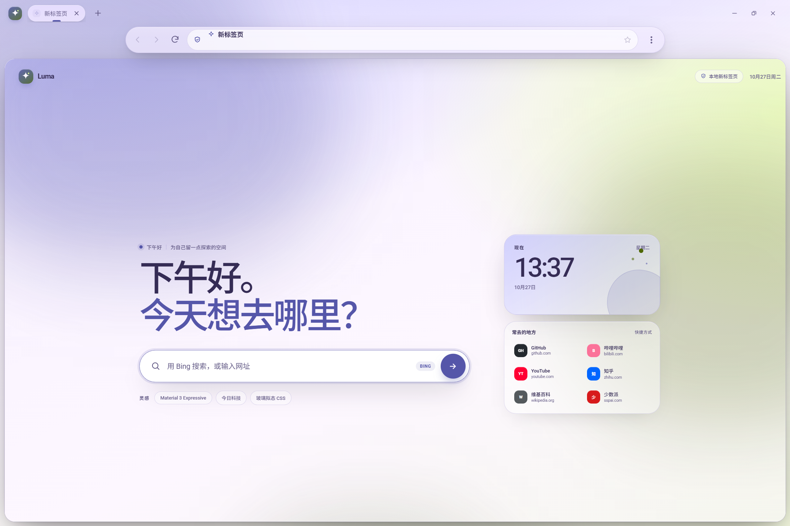
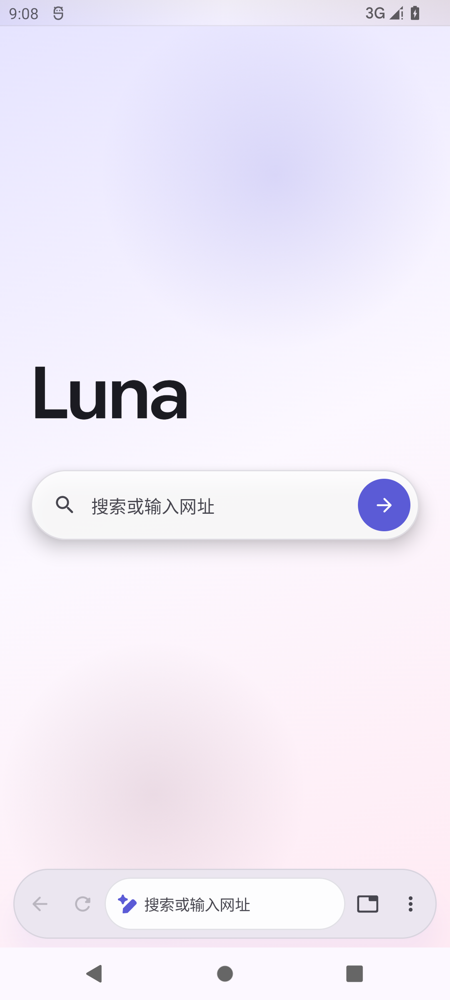
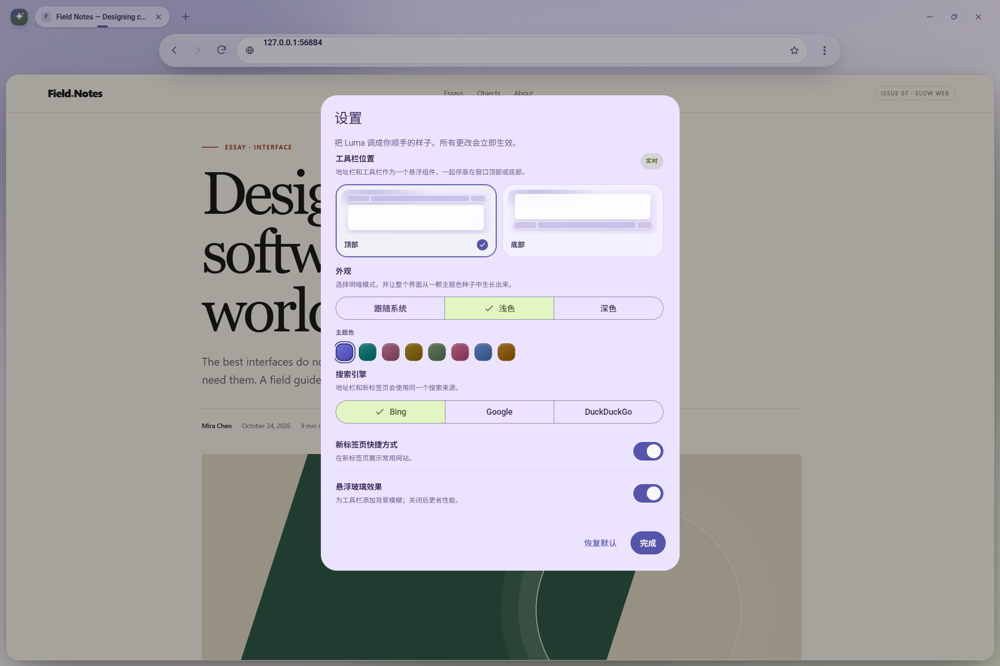
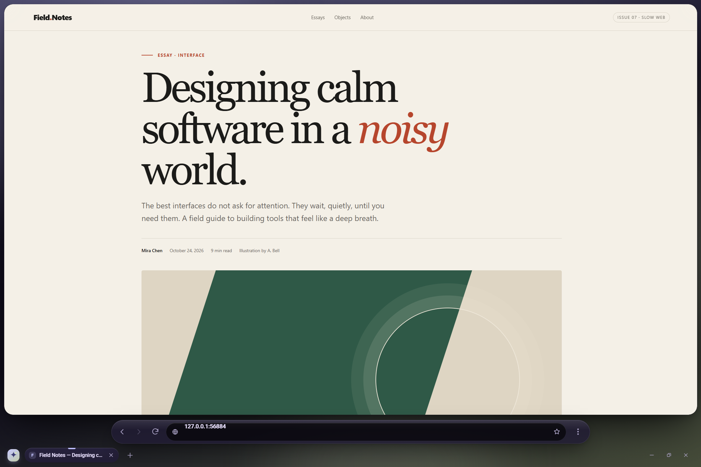
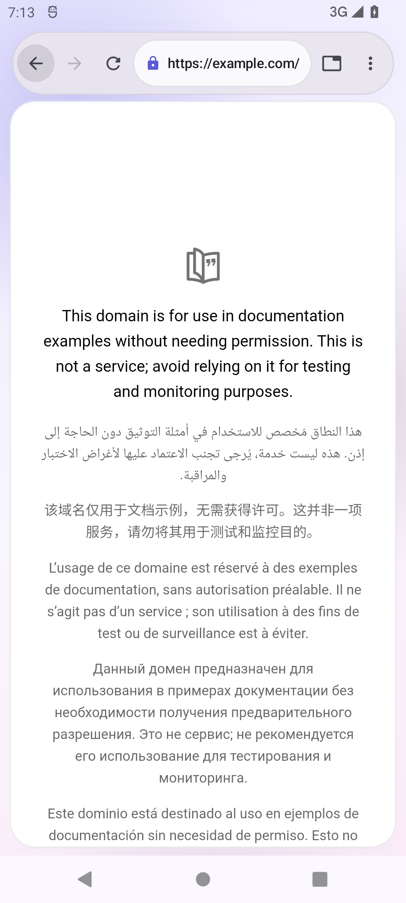
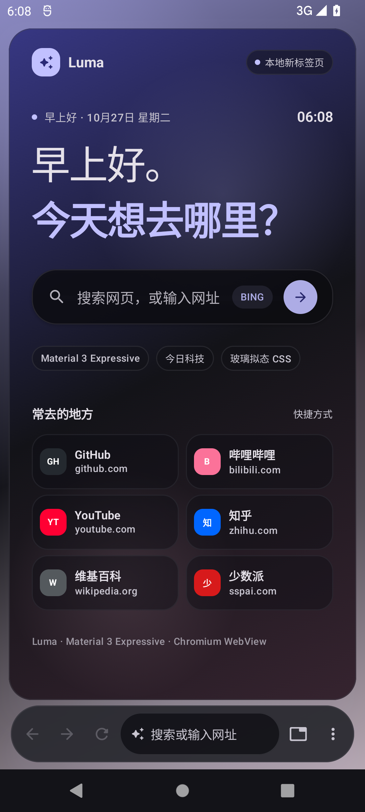

# Luma

**Luma** 是一个把地址栏做成悬浮玻璃胶囊的浏览器。地址栏与工具栏一起停靠在窗口顶部或底部，可在设置里实时切换；网页内容装在一张圆角卡片里，随工具栏自动让位。

界面基于非官方 Material 3 Expressive Web Components 库 [`@materialwebunofficial/md3e-web`](https://materialwebunofficial.github.io/#home)，动态色、形状和弹簧动效全部来自 md3e tokens。

[](https://github.com/ichiyotsu/Discover/releases/tag/v0.1.0)

| 桌面端 | Android |
| --- | --- |
|  |  |

## 下载

Release **0.1.0**：

- **Android**：`Luma-0.1.0-android.apk`，最低 Android 12（API 31），使用系统 Chromium WebView。
- **Windows x64**：源码随仓库发布；运行 `pnpm install && pnpm package` 生成便携包。218MB 的便携包本次未随 Release 上传。
- **源码**：GitHub 自动生成 Source code zip。

前往 [GitHub Releases](https://github.com/ichiyotsu/Discover/releases/tag/v0.1.0) 下载。

> 0.1.0 是首个公开预览版，安装包用调试密钥签名，适合本地体验，不适合上架应用商店。

## 截图

| 桌面设置 | 桌面 · 底部工具栏 · 深色 |
| --- | --- |
|  |  |

| Android 浏览器 | Android · 深色 |
| --- | --- |
|  |  |

## 桌面端

### 功能

- **悬浮地址栏 + 工具栏**：同一组玻璃组件，支持顶部 / 底部停靠，切换时页面自动重排。
- **Chromium 内核**：Electron 45 内置 Chromium；网页运行在隔离 WebView 中，禁用 Node 集成。
- **多标签页**：新建、关闭、重开、顺序切换；独立标题、favicon、加载状态。
- **地址栏**：网址识别、搜索引擎回退、本地历史 / 书签补全、键盘上下选择、安全状态、复制网址。
- **书签与历史**：本地持久化、搜索、清空、撤销、书签星标。
- **自定义新标签页**：本地生成、不联网；时间、问候、快捷方式、搜索。
- **设置**：顶部 / 底部工具栏、跟随系统 / 浅色 / 深色、8 种主题色种子、搜索引擎、快捷方式、玻璃效果。
- **md3e 设计系统**：HCT 动态色、Material Symbols、弹簧动效、`md-dialog`、`md-switch`、`md-segmented-button`、`md-progress-indicator`。
- **原生感窗口**：无边框窗口、自绘窗口控制、拖拽区、窗口位置记忆。

### 从源码运行

要求：Node.js 20+、pnpm 9+。

```powershell
pnpm install
pnpm start
```

`pnpm start` 会把 md3e 运行时同步到 `src/renderer/vendor/md3e`，然后启动 Electron。

开发模式：

```powershell
pnpm dev
```

### 构建 Windows 版

```powershell
pnpm package
```

产物在 `dist/Luma-win32-x64`。

### 快捷键

| 操作 | 快捷键 |
| --- | --- |
| 聚焦地址栏 | `Ctrl L` |
| 新建 / 关闭标签页 | `Ctrl T` / `Ctrl W` |
| 重开关闭的标签页 | `Ctrl Shift T` |
| 切换标签页 | `Ctrl Tab` / `Ctrl Shift Tab` |
| 按序号切换 | `Ctrl 1` … `Ctrl 8`，`Ctrl 9` 最后一个 |
| 后退 / 前进 | `Alt ←` / `Alt →` |
| 刷新 / 强制刷新 | `Ctrl R` / `Ctrl Shift R` |
| 缩放 | `Ctrl +` / `Ctrl -` / `Ctrl 0` |
| 历史记录 / 下载内容 | `Ctrl H` / `Ctrl J` |
| 设置 | `Ctrl ,` |
| 全屏 | `F11` |

## Android

`android/` 是同一产品的原生 Android 版本：Jetpack Compose + Android WebView（Chromium）。

- 悬浮工具栏支持顶部 / 底部停靠，设置持久化。
- 地址栏支持网址识别、搜索、历史补全；底部模式下键盘弹出时工具栏自动上移。
- 标签页切换底部面板、历史记录面板、设置面板。
- 明暗模式、搜索引擎、下载、新窗口、系统返回。
- md3e 本身是 Web Components，不能直接运行在 Compose 中；Android 端按同一套设计语言复刻了动态色、大圆角、胶囊形状和弹簧动效。

构建：

```powershell
cd android
$env:JAVA_HOME = "D:\Application\Android Studio\jbr"
.\gradlew.bat assembleRelease
```

产物在 `android/app/build/outputs/apk/release/app-release.apk`。详见 [`android/README.md`](android/README.md)。

## 项目结构

```text
src/main/main.js          Electron 主进程：窗口、WebView 安全边界、权限、下载、快捷键
src/main/preload.js       contextBridge API
src/renderer/index.html   浏览器 UI 骨架
src/renderer/styles.css   md3e 悬浮界面与响应式布局
src/renderer/app.js       标签、地址栏、历史、书签、设置、窗口交互
src/renderer/newtab.*     本地新标签页
src/renderer/vendor/md3e  md3e 运行时（由 sync:vendor 同步，不手改）
android/                  Kotlin + Compose + WebView 原生 Android 版本
scripts/                  资源同步与打包
tests/                    Playwright 测试、本地示例站点
docs/                     截图
```

## 测试

```powershell
pnpm test:flow       # 真实加载、标签、书签、补全、错误页、主题、工具栏位置
pnpm test:packaged   # 启动打包后的 Luma.exe，验证 asar 内的本地页面
```

Android 端在 Android 12（API 31）模拟器上验证过启动、导航、顶部/底部切换、标签页和键盘避让。

## 已知限制

- Electron 与系统 WebView 都不包含 Widevine；Netflix 等 DRM 流媒体不可用。
- `window.open` 登录流程会转成新标签页；少数依赖 opener 的 OAuth 流程可能失败。
- 没有扩展商店、账户同步、自动更新。
- Android 端暂不包含书签管理、Incognito、跨进程标签恢复。
- 桌面打包版未做代码签名，Windows SmartScreen 可能提示未知发布者。
- Android 安装包使用调试密钥签名，适合本地安装体验。

## 许可

Luma 源代码采用 Apache License 2.0。md3e 是独立开源项目，同样使用 Apache License 2.0，详见 [`THIRD_PARTY_NOTICES.md`](THIRD_PARTY_NOTICES.md)。
